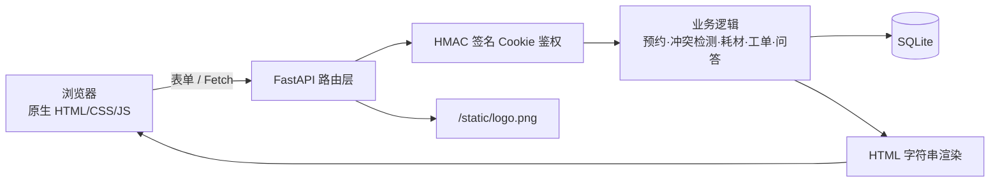

# 3D 打印机预约与运维管理系统

> 电子科技大学（UESTC）英才科协 · 3D 打印实验室
> 原生 HTML + FastAPI + SQLite 的轻量实验室系统，打通「预约 → 审批 → 打印 → 完成」全流程，并覆盖耗材核算、故障工单与互助问答。

## 核心功能与创新点

- **预约登记及维修记录**：预约申请及审批，设备维修登记，使用完成后任务登记。
- **精细耗材核算**：打印机 A/B/C 各自独立 5000g，按机扣减、按机校验，审批超量直接拦截。
- **动态时段防撞单**：提交与审批双重校验时间重叠；学生提前登记完成，时段立即释放。
- **智能耗材预测**：按近 7 天日均消耗推算，单个打印机耗材剩余低于 300g 时页面顶部红色预警。
- **智能空闲时段推荐**：一键统计明日占用，自动填入最空闲的一小时。
- **故障助手 + 知识沉淀**：6 类内置方案 + 管理员回复 + 同学经验三方合并展示；工单「待解决 → 待确认 → 已解决」闭环。
- **互助问答社区**：可匿名提问/回答、搜索、折叠、点赞、管理员可管理、自己问题被回答时有提示（非匿名条件下）。

## 测试账号

| 角色 | 账号 | 密码 | 说明 |
| --- | --- | --- | --- |
| 学生 | `20261101` | `123456` | 张三 · 计算机大类1班 |
| 学生 | `20261102` | `123456` | 李四 · 计算机大类2班 |
| 管理员 | `admin` | `admin` | 审批 / 维修 / 工单 / 审核 |

> 登录前需在下拉框选择「学生登录 / 管理员登录」。

## 环境要求
- 运行设备需已安装 Docker 及 Docker Compose 插件（无需额外配置 Python/Node 环境，全量容器化）。

## 一键运行

```bash
git clone https://github.com/<your-name>/<your-repo>.git
cd <your-repo>
docker compose up -d --build
```

浏览器打开 **http://localhost:8000** 即可使用（首次启动自动建表并初始化 3 × 5000g 耗材）。

修改代码后执行 `docker compose up -d --build` 重新构建；端口冲突可改 `docker-compose.yml` 的 `"8000:8000"`。

## 系统架构



## 目录结构

```text
.
├── app/
│   ├── main.py          # 后端 + 页面渲染（单文件）
│   ├── requirements.txt  # fastapi / uvicorn
│   └── logo.png          # 校徽（挂载为 /static）
├── data/                 # SQLite 数据（挂载持久化）
├── Dockerfile
├── docker-compose.yml
└── README.md
```

## 数据持久化

- `docker-compose.yml` 已将 `./data` 挂载到容器 `/app/data`，SQLite 文件落在 `data/test.db`。
- 重启、`docker compose down`、重新构建镜像均**不会丢失**预约、耗材与问答数据。
- 仅首次建库时初始化库存；如需重置，停止服务后删除 `data/test.db` 再启动即可。
- 建议 `.gitignore` 忽略 `data/` 与 `__pycache__/`，避免把演示数据提交到仓库。
